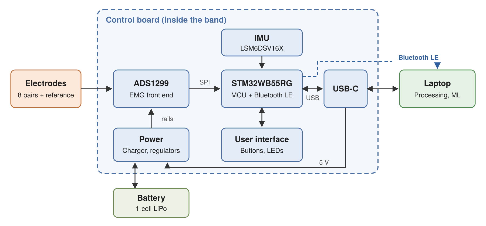
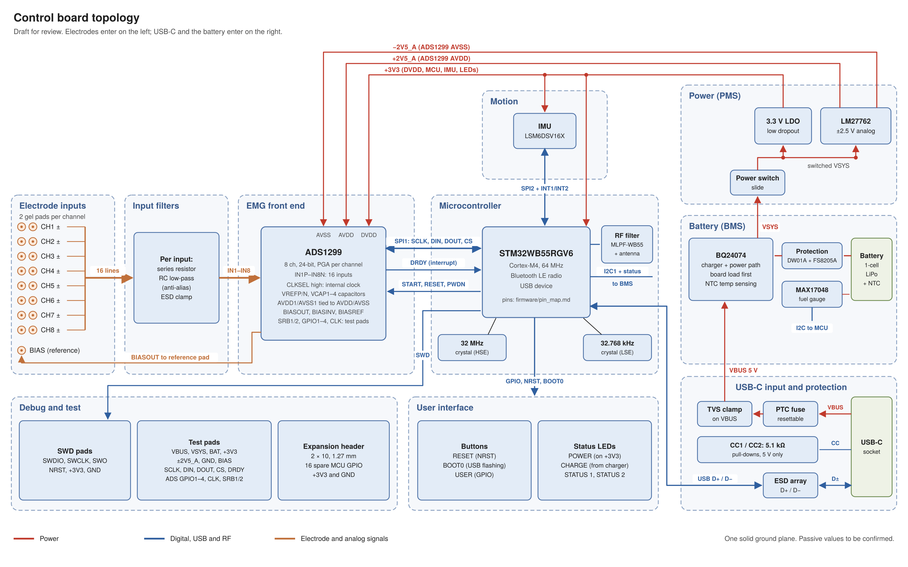

# EMG Band

A multi-channel EMG armband that reads muscle signals from the forearm and is designed to adapt to different bionic devices. The current version is being built to control BioTron's bionic arm.

<p align="center">
  
</p>

## How EMG works

When a muscle contracts, nerve signals make its fibres fire small electrical pulses. Electrodes on the skin pick up the combined activity as a signal of a few millivolts or less. Each channel measures the voltage difference between two electrodes over a muscle, and a reference electrode on a bony spot holds the body at a steady voltage relative to the circuit. The band amplifies and digitizes these signals so software can tell which muscles are working and how hard.

For a short illustrated introduction, including the data rates and where the electrodes go, see [docs/EMG_Theory.pdf](docs/EMG_Theory.pdf).

## Hardware

Everything is on a single control board in a housing on the outside of the band. The band holds 8 electrode pods, one per channel, each with two electrodes fixed 2 cm apart, so the spacing is the same every time the band goes on. Only the reference pad leaves the band, on a lead to the wrist bone. Firmware sets how many channels are active. The board runs from USB-C or a rechargeable battery, switching between them automatically, and charges the battery whenever USB-C is plugged in. Firmware chooses whether data goes out over USB or Bluetooth Low Energy. The control board is in design.

<p align="center">
  
</p>

- **Electrodes:** 8 pods with 2 electrodes each (16 total), plus 1 shared reference pad on a lead
- **EMG front end:** Texas Instruments ADS1299, an 8-channel, 24-bit analog-to-digital converter made for biopotential signals, with built-in programmable gain and a bias drive for the reference electrode
- **Microcontroller:** STM32WB55RGV6 with a built-in Bluetooth Low Energy radio; reads the ADS1299 over SPI and streams the data over USB or Bluetooth. Pin assignments are in [control-board/firmware/pin_map.md](control-board/firmware/pin_map.md)
- **Motion sensing:** LSM6DSV16X 6-axis IMU (accelerometer and gyroscope)
- **Battery management:** BQ24074 charger with power path: on USB the board's circuits are powered first and only the spare current charges the battery, and the board still runs with a flat or missing battery; DW01A and FS8205A battery protection against overcharge, overdischarge and overcurrent; MAX17048 fuel gauge; battery temperature sensing
- **Power management:** power switch, 3.3 V low-dropout regulator, and an LM27762 low-noise ±2.5 V supply for the ADS1299
- **USB-C input:** resettable fuse, surge and ESD protection, 5 V only
- **User interface:** reset, BOOT0 and user buttons; power, charge and status LEDs
- **Debug and expansion:** SWD pads, test pads on the main rails and signals, and a 2 × 10 header with the 16 spare MCU pins

## Specifications

### Board

| Specification | Value |
|---|---|
| Channels | 8 (firmware sets how many are active) |
| Electrodes | 16 in 8 fixed pods (2 cm apart), plus 1 shared reference |
| Resolution | 24-bit |
| Sample rate | 1,000 samples per second per channel |
| EMG data rate | 24 kB/s for 8 channels (8 × 24 bits × 1,000 samples/s) |
| Power | USB-C (5 V) or single-cell LiPo battery |
| Data | USB 2.0 full speed or Bluetooth Low Energy |
| PCB | One rigid 4-layer board |

### Microcontroller: STM32WB55RGV6

| Specification | Value |
|---|---|
| Cores | Arm Cortex-M4 at 64 MHz with FPU and DSP instructions; Arm Cortex-M0+ at 32 MHz runs the radio |
| Memory | 1 MB flash, 256 KB RAM |
| Radio | Bluetooth Low Energy 5 with 2 Mbps mode, up to +6 dBm; 4.5 mA receive, 5.2 mA transmit at 0 dBm |
| Interfaces | USB 2.0 full speed, 2 × SPI, 2 × I2C, USART, LPUART |
| I/O | 49 GPIO, 12-bit ADC with 16 external channels |
| Supply | 1.71 to 3.6 V |
| Package | VFQFPN68, 8 × 8 mm |

### EMG front end: ADS1299

| Specification | Value |
|---|---|
| Channels | 8, sampled simultaneously |
| Resolution | 24-bit delta-sigma |
| Gain | Programmable, 1 to 24 |
| Data rate | 250 to 16,000 samples per second |
| Extras | Bias drive amplifier, lead-off detection, test signals, internal reference and oscillator |
| Supplies | Analog 4.75 to 5.25 V (here ±2.5 V), digital 1.8 to 3.6 V |

### Power budget (estimate)

Battery at 3.7 V, all 8 channels streaming over Bluetooth:

| Block | Current from the battery |
|---|---|
| ADS1299 analog, 8 channels (through the ±2.5 V supply) | ~14.7 mA |
| ADS1299 digital | ~1.0 mA |
| MCU running at 64 MHz | ~3.4 mA |
| Bluetooth radio while streaming | ~4 mA |
| IMU | ~0.7 mA |
| LEDs (power and one status) | ~2 mA |
| Fuel gauge, charger and regulators | ~0.5 mA |
| **Total** | **~26 mA (about 100 mW)** |

The ±2.5 V supply roughly doubles the ADS1299's 7.1 mA analog current at the battery, because the positive side is regulated down and the negative side is made by a charge pump. On a 500 mAh battery that is about 15 to 19 hours of streaming. Over USB the radio is off and the USB peripheral is on, so the total is similar. These numbers come from datasheet typical values and will be replaced with measurements from the real board.

## Repository layout

```
control-board/firmware/   STM32WB55 firmware and pin map
control-board/pcb/        KiCad project for the control board
mech/                     Band enclosure CAD
docs/                     EMG theory guide, datasheets and block diagrams
```

## Getting the files

```bash
cd ~/Desktop
git clone https://github.com/peteryazdi/EMG-Band.git
```

This works in Terminal on macOS and Linux and in PowerShell on Windows. Open the `.kicad_pro` file in `control-board/pcb` with KiCad 10.

## Safety

This is an educational project, not a certified medical device, and it is not intended for diagnostic or clinical use.

- When the band is worn and streaming over USB, the laptop must run on battery, unplugged from its wall charger, so the wearer is never connected to mains wiring through the USB cable.
- Do not wear the band while it is charging from a wall adapter.
- Use a single-cell LiPo battery with its own built-in protection circuit.

## License

MIT. See [LICENSE](LICENSE).
